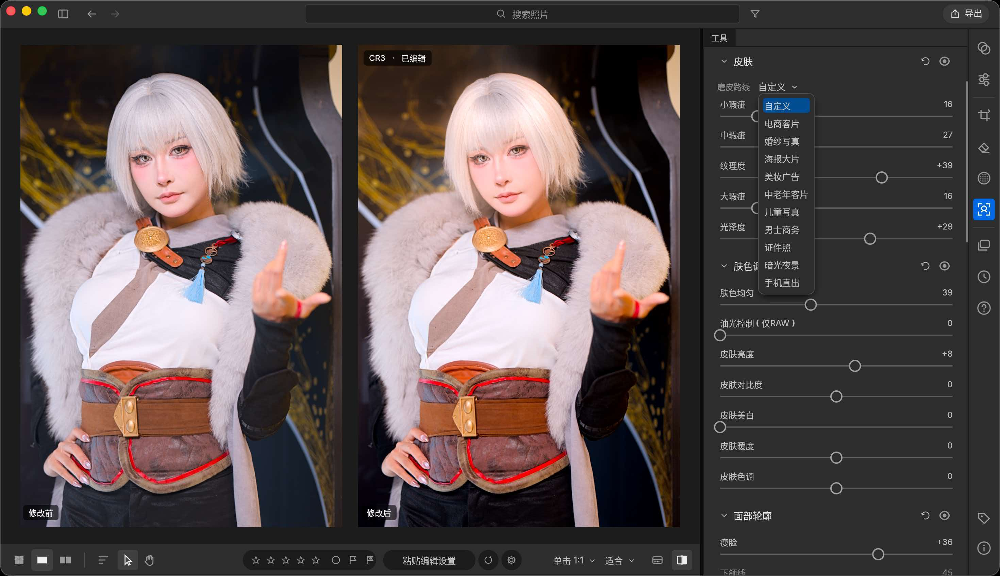
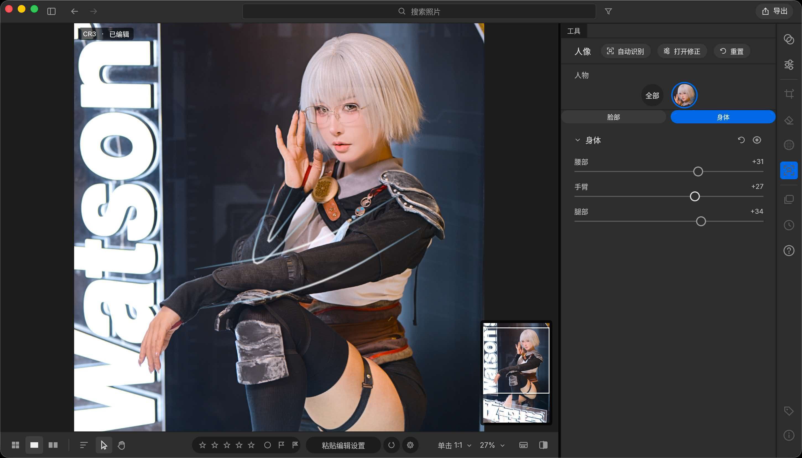
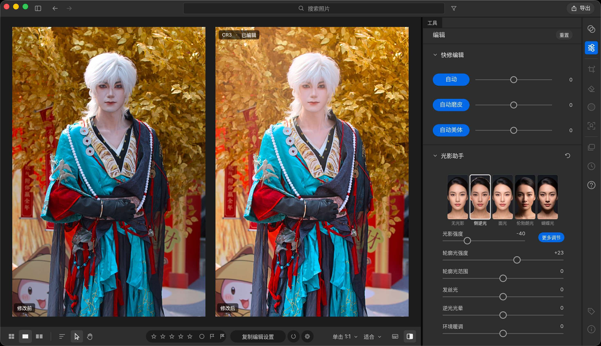
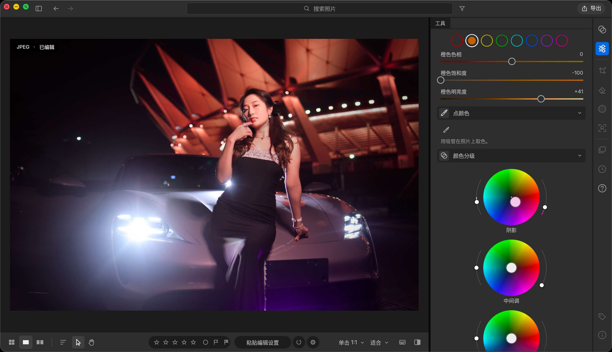
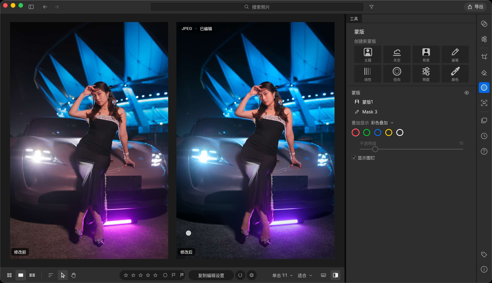
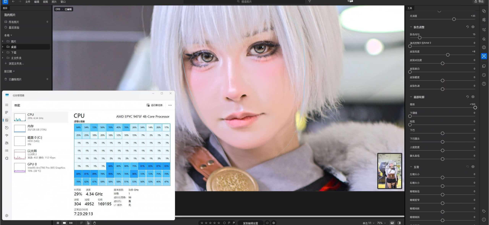

  <a href="README.md">简体中文</a> ·
  <b>English</b>

# DARKRAW

**Built from a photographer's point of view — RAW editing, liquify, skin retouch and color grading in one window**

*Fast RAW editing · Liquify · Skin retouch · Color grading — built in pure Rust*

-lightgrey)

[Download latest](../../releases/latest) · [Report an issue](../../issues)

---

## What is this

DARKRAW is a desktop RAW processing application developed independently by a photographer. The problem it solves is very specific: **retouching a single portrait RAW usually means bouncing between three or four applications** — one to decode and grade, one to liquify, one to retouch skin, then back to the first one for another grading pass. DARKRAW folds all of these steps into one workflow, so you can open a file and finish the whole job in a single window.

Speed is the first priority: multi-core scheduling and the graphics pipeline are tuned for real retouching workloads, and on most hardware they will saturate the available compute, keeping color grading and liquify feedback as close to real time as possible.

> From 0.1 to 0.7, everything was developed single-handedly by me.

## What's new in 0.7.0

| Update | Description |
| --- | --- |
| **First macOS release** | Native Apple Silicon build, runs directly on M-series chips (Intel Macs are not supported yet) |
| **Fujifilm digital film color** | A new Fujifilm digital film look in the color presets — classic film tonality in one click |
| **Portrait Light** | Relight a subject's face in post and rebuild the light hierarchy across facial features |
| **Body detection is here** | Automatically detects hands, waist and legs for more precise, less effortful liquify |
| **Performance improvements** | Rewritten multi-core scheduling and graphics pipeline, now saturating most hardware |

## Screenshots

### Facial detail and skin retouch

Skin retouching is split into three levels — blemish / medium blemish / large blemish — with independent controls for texture, gloss and skin-tone evenness. Cool light control (RAW only) provides skin brightness, contrast, whitening, warmth and tint; facial contour offers refinements such as face slimming. The right panel also ships with skin presets for wedding portraits, poster/fashion shots, beauty campaigns, children's portraits, men's business portraits and ID photos.

### Body detection

The portrait panel supports automatic detection, correction toggle and one-click reset, with separate face and body sections. The body section exposes independent waist, arm and leg parameters, so after detecting key body parts you can reshape the figure directly — faster and more accurate liquify work.

### Portrait Light

Five built-in light patterns — no light, side backlight, top light, Rembrandt light and butterfly light — switchable in one click. Adjust light strength, rim light strength and range, hair light, backlight halo and ambient warmth to relight a face and rebuild the light hierarchy.

### HSL and color grading

Adjust hue, saturation and luminance per hue channel, or use the color picker to sample a color directly from the photo and target a single color range. Color grading provides three independent wheels for shadows, midtones and highlights.

### Masks

Create masks from subject, sky, background, brush, as well as linear, radial, luminance and color masks. Overlay display can switch to a colored annotation, with pins to confirm the affected area and adjustable opacity.

### Multithreaded processing

Multi-core scheduling in practice: AMD EPYC 9475F (48 cores / 96 threads). During real-time processing, **51 of the 96 logical processors were above 10% utilization** — rows 1, 2, 6, 7 and 8 stayed largely under heavy load (peaking locally between 76% and 95%), while the GPU participated in the graphics pipeline at the same time. Even high-megapixel RAW files keep plenty of parallelism.

## Key features

### RAW editing
- Reads camera RAW files directly, with fast decoding and preview
- Exposure, contrast, highlight/shadow, white balance and other basic adjustments apply in real time
- Non-destructive editing workflow, reversible at any time

### Liquify
- Push, pull, bloat and pinch — the usual liquify brushes
- **Body detection**: automatically locates hands, waist and legs for fine local reshaping
- Brush response stays fluid even at high resolution

### Skin retouch
- Smart retouching that preserves skin texture and avoids the "plastic" look
- Three-level blemish handling (small / medium / large), with independent texture, gloss and skin-tone evenness controls
- Cool light control (RAW only): skin brightness, contrast, whitening, warmth, tint
- Bundled skin presets (wedding portraits, poster/fashion, beauty campaigns, children's portraits, men's business portraits, ID photos, and more)

### Color grading and presets
- Multiple built-in color presets, including the new **Fujifilm digital film** look
- Presets are a starting point — further adjustments are never locked
- Tone curves tuned for portraits and everyday scenes
- **HSL**: per-hue-channel control of hue, saturation and luminance, with an eyedropper for targeted adjustments
- **Color grading**: three independent wheels for shadows, midtones and highlights

### Portrait Light
- A relighting tool built for portraits
- Five built-in light patterns: no light, side backlight, top light, Rembrandt light, butterfly light
- Adjustable light strength, rim light strength and range, hair light, backlight halo and ambient warmth

### Masks
- Smart masks: subject, sky, background, plus freehand brush
- Shape masks: linear, radial, luminance, color
- Colored overlay display and pin markers to confirm mask coverage, with adjustable opacity

## Download and installation

Head to the [Releases](../../releases) page and download the archive for your platform.

### Windows (x64)

1. Download `DARKRAW-0.7.0-win-x64.zip`
2. Extract it to any folder (a non-system drive is recommended)
3. Double-click `DARKRAW.exe` to run

Portable — no installation and no extra runtimes required.

### macOS (Apple Silicon / M series)

> M-series chips only. Intel Macs are not supported yet.

1. Download `DARKRAW-0.7.0-macos-aarch64.zip`
2. Extract it to get a `.dmg` disk image, then double-click to open it
3. Drag the DARKRAW icon into the Applications folder to finish installing
4. Launch it from Applications. If macOS says the developer cannot be verified on first launch, go to System Settings → Privacy & Security and click "Open Anyway" once

No command line work and no extra runtimes required.

## System requirements

- **Windows**: Windows 10 / 11 (64-bit)
- **macOS**: Apple Silicon (M1 / M2 / M3 / M4 series)
- **GPU**: discrete or integrated both work; the graphics pipeline uses whatever compute is available
- **Memory**: 16GB or more recommended for comfortable handling of high-megapixel RAW files

## Tech stack

- Built on **LightCraft** (a photo library and RAW development engine written in pure Rust)
- All logic implemented in **pure Rust**, with no heavyweight runtime dependencies
- Image and portrait capabilities are powered by **open-source models**
- Development tooling: **TRAE IDE**

## Built on LightCraft — thanks to open source

DARKRAW's foundation is built on **LightCraft** — a cleanly implemented, pure Rust photo library and RAW development engine (MIT OR Apache-2.0). Respect to its upstream author, and thanks to every open-source project and model this application uses and to the people behind them.

| Project / Model | Author / Source | Purpose | License |
| --- | --- | --- | --- |
| LightCraft | storytold (the upstream project this app is built on) | Base framework | MIT OR Apache-2.0 |
| egui · eframe · egui_extras | Emil Ernerfeldt and contributors | UI | MIT OR Apache-2.0 |
| wgpu | the gfx-rs community | GPU rendering and compute | MIT OR Apache-2.0 |
| rayon | the rayon-rs project | Data parallelism | MIT OR Apache-2.0 |
| Serde · serde_json | David Tolnay and contributors | Serialization | MIT OR Apache-2.0 |
| image · png · zune-jpeg · tiff | their respective authors | Image codecs | MIT OR Apache-2.0 |
| candle | Hugging Face | Tensor operations | MIT OR Apache-2.0 |
| YuNet (face detection, 5 landmarks) | Shiqi Yu, via OpenCV Zoo | Face detection | MIT |
| PP-HumanSeg (portrait segmentation) | Baidu PaddleSeg, exported by OpenCV Zoo | Portrait segmentation | Apache-2.0 |
| RawNIND UtNet2 (Bayer denoising) | darktable-ai, trained on the RawNIND dataset | RAW denoising | GPL-3.0 |

> Copyright for each component belongs to its original authors and is distributed under its respective license. Full license texts ship with the installer.

## Changelog

### v0.7.0
- Added the macOS (Apple Silicon) build
- Added Fujifilm digital film color to the color presets
- Added Portrait Light for relighting a subject's face
- Body detection is now available for liquify on hands, waist and legs
- Optimized multi-core scheduling and the graphics pipeline, saturating most hardware

## Feedback

If you run into a problem or have a feature suggestion, feel free to open an [issue](../../issues). Including a sample file (or comparable reproducible material), your system information and the steps you took will make it much faster to pin down.

## Notes

This project is developed and maintained independently by one person. The software is provided as is — please back up your original material; the exported file you save is the authoritative result.
