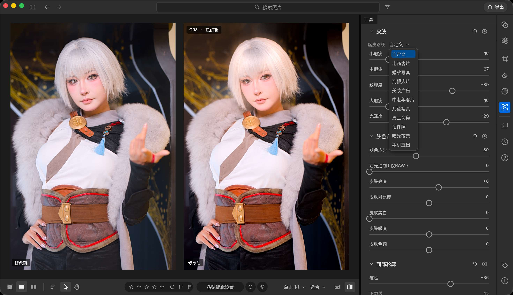
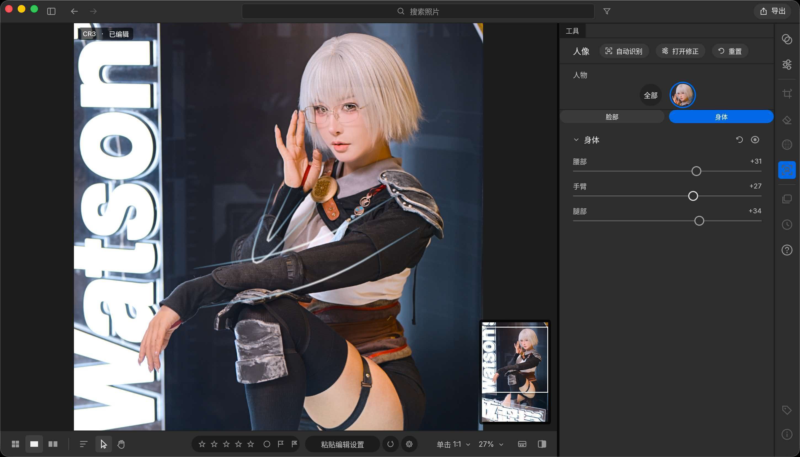
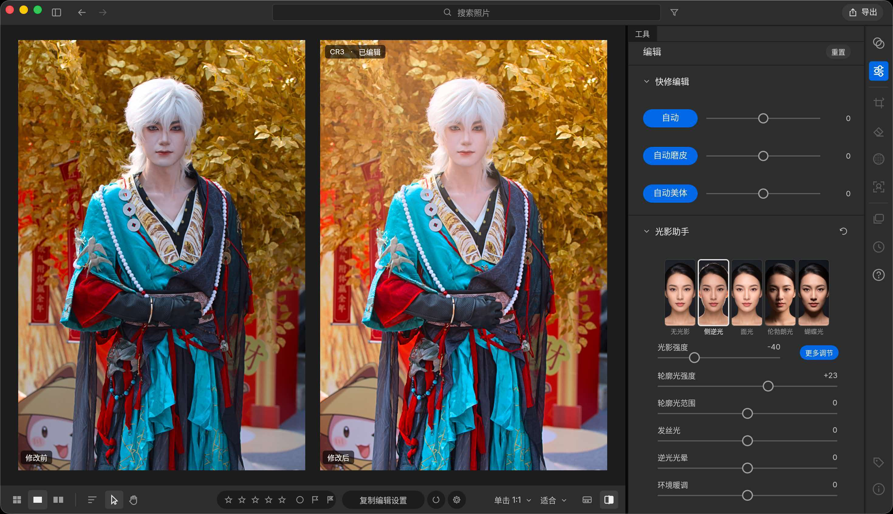
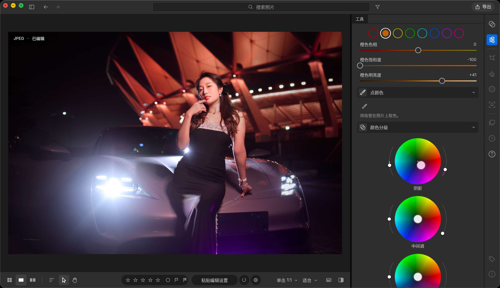
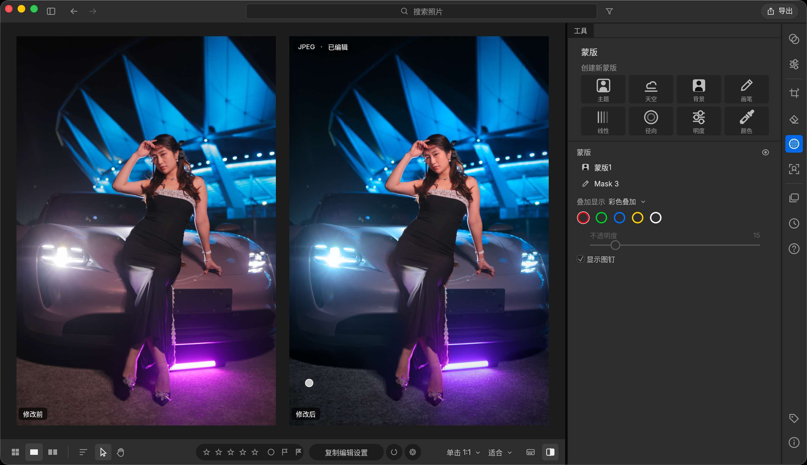
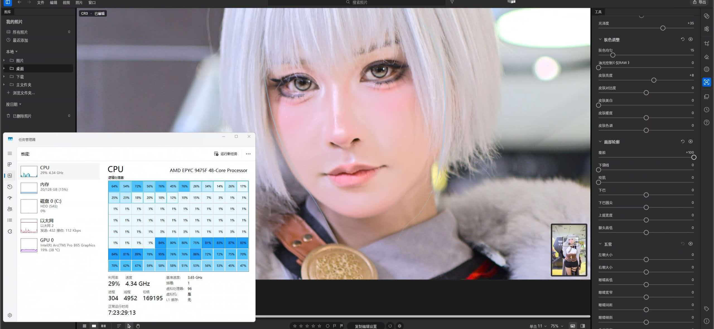

# DARKRAW | 暗房快修

**从摄影师的角度出发，把 RAW 编辑、液化、磨皮、调色放进同一个窗口**

*Fast RAW editing · Liquify · Skin retouch · Color grading — built in pure Rust*

-lightgrey)

[下载最新版本](../../releases/latest) · [问题反馈](../../issues)

---

## 这是什么

DARKRAW 是一款由摄影师独立开发的桌面 RAW 处理软件。它要解决的问题很具体：**修一张人像 RAW，通常要在三四个软件之间来回倒腾**——一个软件解码调色，一个软件液化，一个软件磨皮，再回第一个软件调色。DARKRAW 把这些步骤收进同一个工作流里，打开文件就能一路做完。

软件以「快」为第一优先级：多核调度与图形管线都针对实际修图场景做了优化，在多数硬件上都能把性能吃满，让调色和液化的反馈尽量贴近实时手感。

> 从 0.1 到 0.7，全部由我一个人独立开发完成。

## 0.7.0 更新亮点

| 更新 | 说明 |
| --- | --- |
| **macOS 版本首次发布** | 原生 Apple Silicon 构建，M 系列芯片可直接运行（Intel Mac 暂不支持） |
| **富士数码胶卷色彩** | 色彩预设新增富士数码胶卷风格，一键获得经典胶片影调 |
| **光影助手** | 对人物脸部进行二次打光，重塑面部光影层次 |
| **肢体识别可用** | 自动识别人体手部、腰部与腿部，液化更精准、更省力 |
| **性能优化** | 多核调度与图形管线重构，基本可以吃满多数硬件的性能 |

## 界面预览

### 脸部细节处理与磨皮

磨皮线分成「小瑕疵 / 中瑕疵 / 大瑕疵」三档，纹理度、光泽度、肤色均匀度独立可调；冷光控制（仅 RAW）提供皮肤亮度、对比度、美白、暖度与色调；面部轮廓可做瘦脸等微调。右侧还内置婚纱写真、海报大片、美妆广告、儿童写真、男士商务、证件照等皮肤预设。

### 肢体识别

人像面板支持自动识别、开启修正与一键重置，并按「脸部 / 身体」分区调节。身体部分提供腰部、手臂、腿部三项独立参数，识别人体关键部位后直接微调形体，液化时更省力也更准确。

### 光影助手

内置无光影、侧逆光、顶光、伦勃朗光、蝴蝶光五种光型，一键切换。可调光影强度、轮廓光强度与范围、发丝光、逆光光晕与环境暖调，对人物脸部二次打光、重塑光影层次。

### HSL 和调色

按色相通道分别调整色相、饱和度与明度，并可点选「点颜色」用吸管在照片上取色，定向修改某一种颜色；颜色分级提供阴影、中间调、高光三个独立色轮。

### 蒙版处理

创建蒙版支持主体、天空、背景、画笔，以及线性、径向、明度、颜色四类蒙版；叠加显示可切换彩色标注，配合图钉确认作用范围，不透明度可调。

### 多线程处理

多核调度实测：AMD EPYC 9475F（48 核 / 96 线程）。实时处理期间，96 个逻辑处理器中有 **51 个占用超过 10%**——第 1、2、6、7、8 行基本处于高负载（局部达 76%–95%），GPU 同时参与图形管线。高像素 RAW 也能维持充足的并行度。

## 主要功能

### RAW 编辑
- 直接读取相机 RAW 文件，快速解码与预览
- 曝光、对比、高光阴影、白平衡等基础调整实时生效
- 非破坏式编辑流程，随时回退

### 液化
- 推、拉、膨胀、收缩等常用液化笔刷
- **肢体识别**：可自动定位手部、腰部、腿部，针对局部形体做精细调整
- 高分辨率下依然保持流畅的笔刷响应

### 磨皮
- 保留皮肤质感的智能磨皮，避免「塑料感」
- 小瑕疵 / 中瑕疵 / 大瑕疵分级处理，纹理度、光泽度、肤色均匀度独立可调
- 冷光控制（仅 RAW）：皮肤亮度、对比度、美白、暖度、色调
- 内置多套皮肤预设（婚纱写真、海报大片、美妆广告、儿童写真、男士商务、证件照等）

### 调色与色彩预设
- 内置多组色彩预设，包含新增的**富士数码胶卷**风格
- 预设可叠加后续微调，不锁定参数
- 面向人像与日常场景调校的影调曲线
- **HSL**：按色相通道分别控制色相、饱和度、明度，支持吸管点选颜色定向调整
- **颜色分级**：阴影、中间调、高光三个独立色轮

### 光影助手
- 面向人像的二次打光工具
- 内置无光影、侧逆光、顶光、伦勃朗光、蝴蝶光五种光型
- 可调光影强度、轮廓光强度与范围、发丝光、逆光光晕、环境暖调

### 蒙版
- 智能蒙版：主体、天空、背景，以及画笔手绘
- 形状蒙版：线性、径向、明度、颜色
- 彩色叠加显示与图钉标记，便于确认蒙版作用范围，不透明度可调

## 下载与安装

前往 [Releases](../../releases) 页面下载对应平台的压缩包。

### Windows（x64）

1. 下载 `DARKRAW-0.7.0-win-x64.zip`
2. 解压到任意目录（建议放在非系统盘）
3. 双击 `DARKRAW.exe` 即可运行

绿色免安装，无需额外运行库。

### macOS（Apple Silicon / M 系列）

> 仅支持 M 系列芯片，Intel Mac 暂不支持。

1. 下载 `DARKRAW-0.7.0-macos-aarch64.zip`
2. 解压后会得到一个 `.dmg` 磁盘映像，双击打开
3. 把 DARKRAW 图标拖进「应用程序」文件夹，即完成安装
4. 从「应用程序」中打开即可使用。首次打开如提示「无法验证开发者」，前往「系统设置 → 隐私与安全性」，点击「仍要打开」授权一次

无需命令行操作，也无需额外运行库。

## 系统要求

- **Windows**：Windows 10 / 11（64 位）
- **macOS**：Apple Silicon（M1 / M2 / M3 / M4 系列）
- **显卡**：独显或核显均可，图形管线会尽量利用可用算力
- **内存**：建议 16GB 及以上，处理高像素 RAW 时更从容

## 技术栈

- 基础框架基于 **LightCraft**（纯 Rust 的照片图库与 RAW 显影引擎）
- 全部逻辑以 **纯 Rust** 实现，无重量级运行时依赖
- 图像/人像相关能力基于**开源模型**
- 开发工具：**TRAE IDE**

## 基于 LightCraft，致谢开源

DARKRAW 的基础框架构建在 **LightCraft** 之上 —— 一个干净实现、纯 Rust 的照片图库与 RAW 显影引擎（MIT OR Apache-2.0）。向上游作者致敬，也感谢本程序调用的每一个开源项目与模型及其提供者。

| 项目 / 模型 | 作者 / 来源 | 用途 | 许可证 |
| --- | --- | --- | --- |
| LightCraft | storytold（本程序构建于其上的上游项目） | 基础框架 | MIT OR Apache-2.0 |
| egui · eframe · egui_extras | Emil Ernerfeldt and contributors | 界面 | MIT OR Apache-2.0 |
| wgpu | the gfx-rs community | GPU 渲染与计算 | MIT OR Apache-2.0 |
| rayon | the rayon-rs project | 数据并行 | MIT OR Apache-2.0 |
| Serde · serde_json | David Tolnay and contributors | 序列化 | MIT OR Apache-2.0 |
| image · png · zune-jpeg · tiff | their respective authors | 图像编解码 | MIT OR Apache-2.0 |
| candle | Hugging Face | 张量运算 | MIT OR Apache-2.0 |
| YuNet（人脸检测，5 关键点） | Shiqi Yu, via OpenCV Zoo | 人脸检测 | MIT |
| PP-HumanSeg（人像分割） | Baidu PaddleSeg, exported by OpenCV Zoo | 人像分割 | Apache-2.0 |
| RawNIND UtNet2（Bayer 降噪） | darktable-ai, trained on the RawNIND dataset | RAW 降噪 | GPL-3.0 |

> 各组件版权归其原作者所有，按各自许可证分发。完整的许可证文本随安装包一同分发。

## 更新日志

### v0.7.0
- 新增 macOS（Apple Silicon）版本
- 色彩预设新增富士数码胶卷色彩
- 新增光影助手，可对人物脸部二次打光
- 肢体识别可用，可对手、腰和腿部进行液化处理
- 针对多核与图形管线进行优化，基本可以吃满多数硬件性能

## 反馈

使用中遇到问题或有功能建议，欢迎提交 [Issue](../../issues)。如果能附上样片（或同类型可复现的素材）、系统信息与操作步骤，定位会快很多。

## 说明

本项目为个人独立开发与维护。软件按现状提供，请自行备份原始素材；处理结果以你自己导出保存的文件为准。
